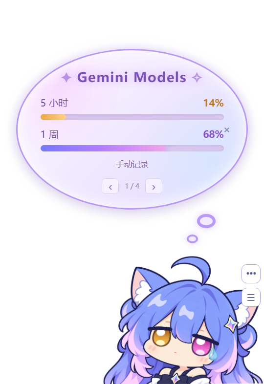
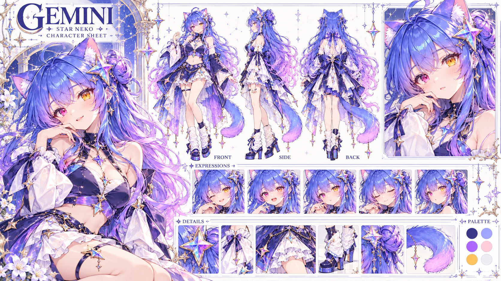

# 星语 · Antigravity Star Suite

给 Antigravity 添一点蓝紫色星光：一个 Gemini 猫娘桌宠，以及一套可随时撤回的桌面皮肤。

**两个插件独立启动、独立设置。Windows x64 本地项目，非 Google 官方产品。**

<p align="center"></p>

## 喵言喵语 · Cat Widget

<p align="center"></p>

图中 14% / 68% 为隔离测试手动填写的演示数据，不是公开账号额度。

- 半身猫娘、按压与弹性回弹、拖动、左右下角吸附和转身，支持 140–360 像素大小。
- 额度气泡提供 **Gemini Models 5 小时 / 1 周两根额度条**；低于等于 30% 为琥珀色，低于等于 10% 为玫红色。
- 气泡默认收起，点击展开；空闲约 6.5 秒收起，悬停暂停。四页依次是 Gemini Models、喵言喵语、今日用量、最近步骤；台词页点击角色换句。
- 50 句中文傲娇台词、可关闭的得意与委屈彩蛋、呼吸和流光；减少动态设置可停用动态效果。
- 桌面模式与“仅在 Antigravity 窗口内显示”模式，支持置顶、鼠标穿透、托盘唤回、重启挂件与设置撤回。
- 按下/松开配对音效，公开版包含 **四套、八段**可明确记录许可的音效，默认静音。
- 读取本机日志中的数值元数据，按会话和模型步骤去重，保留最近 90 天账本，不保存聊天正文。
- 为宿主最小化恢复、休眠恢复、辅助进程失联、渲染崩溃与空白画面提供恢复处理。

### 额度怎样读取

挂件启动时立即读取宿主已有额度缓存，之后每 30 秒读取一次；不会自动打开设置页。不使用私有额度 RPC，不读取登录凭据。首次没有缓存时显示未知，可自行打开原生 **Settings → Models** 初始化，或在挂件设置点“读取宿主额度”手动打开。

同一宿主目标内，关闭 Models 后保留最近一次读到的数值（包括 0）；超过五分钟或读取异常标记为待更新。**本机读取时间不是服务器更新时间，缓存不等于实时额度。** 切换宿主目标立即清空，重启挂件不从文件恢复额度。同一个宿主内换账号时请重新打开原生 Models 刷新。

版本失配、未初始化缓存或缺失某个周期时显示未知。也可手动分别填写两周期比例，并明确标记手动记录。本机 tokens 不用于推算账户余额或金额，一个模型步骤不等于一整轮任务。

## Dream Skin

<p align="center"></p>

- 蓝紫设定集壁纸与整窗配色，覆盖主内容、侧栏、标题和控件。
- 可调壁纸可见度、遮罩、位置与 100%–200% 缩放，支持拖动预览定位、适配窗口及裁切显示。
- 对话正文可选透明或分段玻璃；输入区域使用圆角半透明玻璃。文字颜色保留，真实代码编辑器和终端保留保护背景。
- 自动重连；关闭开关或从托盘退出会撤销自有节点和样式。支持撤回本次调整、居中复位与恢复默认。
- 通过宿主已有的 localhost CDP 调试端口应用页面内样式，不修改安装目录或 app.asar。

## 从源码运行

需要 Windows 10/11 x64、Node.js 22 或更新版本，以及已安装并运行的 Antigravity。原生辅助程序使用 Windows 自带 .NET Framework C# 编译器。当前实机适配基于 **Antigravity 2.28.0**；宿主更新可能改变页面结构和缓存字段。

```powershell
git clone https://github.com/Monokumakuki/Antigravity-Star-Suite.git
cd Antigravity-Star-Suite
npm ci
npm run build:native
npm run start:widget
npm run start:skin
```

`npm ci` 会下载锁定的 Electron 运行时。若 npm 环境禁止安装脚本，需自行完成 Electron 安装，不能只运行 `npm ci --ignore-scripts` 后直接启动。

皮肤面板中打开“应用到 Antigravity”。宿主没有可用的本地调试端口时，面板显示等待连接；项目不会擅自重启宿主或更改安装文件。两个程序可独立使用。

快捷键：`Ctrl+Alt+G` 唤回挂件；`Ctrl+Alt+Shift+G` 关闭鼠标穿透。右键角色或使用系统托盘打开设置。关闭皮肤控制面板时，已启用的皮肤留在托盘；选择“退出并恢复原样”才会彻底退出。

目前提供源码发布。仓库不含 Electron、编译后的 EXE、本机任务栏快捷方式备份或个人配置；不需要使用旧的本地 0.2.8 ZIP。

## 配置、隐私与撤销

| 数据 | 位置 |
| --- | --- |
| 挂件设置与数值账本 | `%USERPROFILE%/.antigravity-cat-widget/` |
| 皮肤设置 | `%USERPROFILE%/.antigravity-dream-skin/` |
| 本机原始日志（只读） | `%USERPROFILE%/.gemini/antigravity/brain/` |

项目不向外部上传会话内容，不存储 API 密钥或登录令牌。数值账本、启动/恢复日志和 Electron 自身缓存保存在本机。自动化验收输出位于 `evidence/`，不提交 Git。

卸载前从两个托盘退出；皮肤正常退出会还原页面。强制结束导致临时样式残留时，刷新/重开宿主可清除。删除项目目录即可移除程序；保留或自行备份上述用户目录可保留设置。项目默认不注册开机启动，不自动修改任务栏入口。

## 开发与验证

```powershell
npm test
npm run verify:runtime
```

单元测试覆盖额度缓存、去重与增量日志、异常数值、状态机、配置、宿主几何和连接生命周期等。运行检查需要本机 Microsoft Edge，会启动隔离的 Electron 测试窗口和受控浏览器；不会发送模型请求。运行检查与真实桌面合成、长期跨屏稳定性不是同一验证范围。

```text
Antigravity-Cat-Widget/   桌宠、气泡、额度与数值日志适配器
Antigravity-Dream-Skin/   控制面板、壁纸与可撤回宿主样式
shared/                  本地 CDP、持久化与第三方 ws
tools/                   启动、原生编译与隔离验证
```

已知边界：尚无稳定公开的后台实时额度接口；没有云端计费；没有完成 codex-maid 的全部聊天、持久记忆、多账号、预测与管理功能。Windows 原生窗口跟随已在开发机器验证，所有 DPI、多屏、虚拟桌面及数小时稳定性仍需更多反馈。欢迎通过 Issues 附上版本、重现步骤与脱敏截图。

## 来源与许可

原创软件采用 [MIT](LICENSE)。**MIT 不覆盖角色、美术、品牌标识及第三方音频。** 美术来源与范围见 [ASSETS.md](ASSETS.md)，依赖和音效见 [NOTICE.md](NOTICE.md)。

角色设计参考按提供者记录署名 **ZipZipPipe**；角色与设定集图片由 AI 辅助生成，保留生成提示词，不宣称 Google 官方授权或原设的再许可权。公开版未包含原作者参考图、私人截图或未确认再分发许可的 DSH 鸭叫音频。

交互和产品灵感来自 [codex-maid-widget](https://github.com/Feeesack/codex-maid-widget) 与 [DeepSeek-Balance-Whale-Widget](https://github.com/MeteorNOX/DeepSeek-Balance-Whale-Widget)。感谢这些项目的公开实现与音效来源记录。
